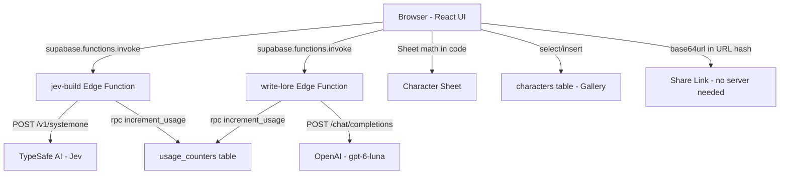

# Retro RPG Character Creator

A full-stack demo app with a fun 8-bit look where you describe a hero in free text (or pick a vibe card) and get a complete retro character sheet: class, alignment, six stats, HP, a procedurally drawn pixel sprite, lore, name ideas, and a portrait description.

Jev (TypeSafe AI's fast "System One" decision model) picks class, alignment, and stat levels from fixed lists, with ALL questions batched into ONE request. Code turns Jev's probabilities into the final sheet (expected values, point-buy normalization, optional dice-roll flavor). The LLM only writes the backstory, name ideas, and portrait description as text and never decides anything on the sheet.

## Architecture



## How It Works

1. **Description** - User types a hero description or picks a vibe card / demo character
2. **Jev (1 request, 10 questions)** - All ten questions (class, law_chaos, good_evil, six stats, is_character) are batched into a single request to TypeSafe AI
3. **Sheet Math (code)** - Pure TypeScript functions compute expected values, point-buy normalization (27 points, 5e cost table), class bonuses, HP, and alignment from Jev's probabilities. Jev never does math.
4. **Lore (LLM)** - OpenAI writes backstory, name ideas, portrait description, and catchphrase. The prompt says the sheet is fixed and must not be changed.

## Setup

### Prerequisites
- Node.js 18+
- A Supabase project (already provisioned)

### Install & Run
```bash
npm install
npm run dev
```

### Configure Secrets (optional - demo works without them)

Set Edge Function secrets via the Supabase dashboard or CLI:

```bash
supabase secrets set TYPESAFE_API_KEY=your_key_here
supabase secrets set OPENAI_API_KEY=your_key_here
supabase secrets set OPENAI_MODEL=gpt-6-luna
supabase secrets set OPENAI_BASE_URL=https://api.openai.com/v1
```

**Without secrets configured**, the app automatically falls back to:
- **Replay mode** for Jev (uses recorded Jev answers for demo characters)
- **Heuristic mode** for custom text (keyword-based class matching)
- **Mock mode** for the LLM (template-based lore generation)

### Deploy Edge Functions

The two Edge Functions are deployed via the Supabase MCP `deploy_edge_functions` tool. They are already configured in `supabase/config.toml` with `verify_jwt = true`.

### Run Migrations

The database migration (characters table, usage_counters, increment_usage function, RLS policies) is applied via the Supabase MCP `apply_migration` tool.

## Environment Variables

| Name | Required | Default | Scope |
|------|----------|---------|-------|
| `TYPESAFE_API_KEY` | No | - | Server-side secret (Edge Function) |
| `OPENAI_API_KEY` | No | - | Server-side secret (Edge Function) |
| `OPENAI_MODEL` | No | `gpt-6-luna` | Server-side secret (Edge Function) |
| `OPENAI_BASE_URL` | No | `https://api.openai.com/v1` | Server-side secret (Edge Function) |
| `VITE_SUPABASE_URL` | Yes | - | Public (browser) |
| `VITE_SUPABASE_ANON_KEY` | Yes | - | Public (browser) |

**Important:** No API key is ever hardcoded, committed, or shipped to the browser. The `.env` file holds only the public `VITE_` values. Server-side secrets are configured via `supabase secrets set`.

## Daily Usage Cap

Each Edge Function has a daily cap of **200 calls per UTC day**. The cap is enforced server-side via the `usage_counters` table and the `increment_usage` SQL function (SECURITY DEFINER, service_role only). When the cap is exceeded, the function returns HTTP 429 and the UI shows "Daily demo limit reached - switching to Replay mode" before falling back to Replay/Mock mode.

The cap fails closed: if the `increment_usage` RPC errors or returns a non-number, the function returns HTTP 503 and makes no external API call.

## Demo Characters

Six one-click demo characters with recorded Jev answers:

1. **Brakka** - A grumpy dwarf blacksmith who hits things until they are fixed
2. **Lumi** - A cheerful necromancer who keeps her skeletons tidy and well dressed
3. **Sable** - A quiet street orphan who picks locks faster than she reads
4. **Brother Oswin** - A former soldier who now heals anyone, even his enemies
5. **Pip** - A halfling lute player who talks his way out of every fight
6. **Vex** - A scholar who made a deal with something in the old library

Each fixture stores the exact Jev request, the recorded response, and a hash of the description. Replay only applies when the input hash matches.

## Design Decisions

- **One batched Jev request with ten question IDs** instead of ten separate calls. Every question is evaluated in parallel against the same state, reducing latency and cost.
- **Jev picks from closed sets; code computes everything else.** Jev is weak at math, so expected values, point-buy normalization, dice rolls, modifiers, and HP are all computed in TypeScript. Jev only chooses from fixed lists (class, alignment) or scores stats on a 5-level rubric.
- **Explicit "uncertain" options and a confidence-gated picker.** If class confidence is below 0.40 or the answer is "uncertain", the UI shows a "The oracle hesitates..." picker with the top three classes and their probabilities. Same for each alignment axis.
- **The LLM only writes lore and never changes the sheet.** The prompt explicitly says the sheet is fixed. The LLM produces backstory, names, portrait description, and catchphrase only.
- **No temperature parameter.** `gpt-6-luna` rejects it. Chat requests send only `model`, `messages`, and `response_format`.
- **Labeled Replay fixtures.** Replay sheets get a visible gold "REPLAY: recorded Jev answers" badge, never presented as live.
- **Two Edge Functions** to stay under Bolt's deploy limit (max 5 calls per run). Share links and the gallery use the Supabase client directly.

## Screenshots

<!-- Add screenshots here -->
- Title screen with blinking "PRESS START"
- Character generation pipeline
- Character sheet with pixel sprite and stat bars
- "Why this sheet?" panel with Jev distributions
- Gallery of shared characters

## Tech Stack

- Vite + React + TypeScript + Tailwind CSS
- Supabase (Postgres + Edge Functions / Deno)
- lucide-react (icons)
- framer-motion (animations)
- html-to-image (PNG export)
- zod (validation)
- Fonts: Press Start 2P (headings), VT323 (body)
